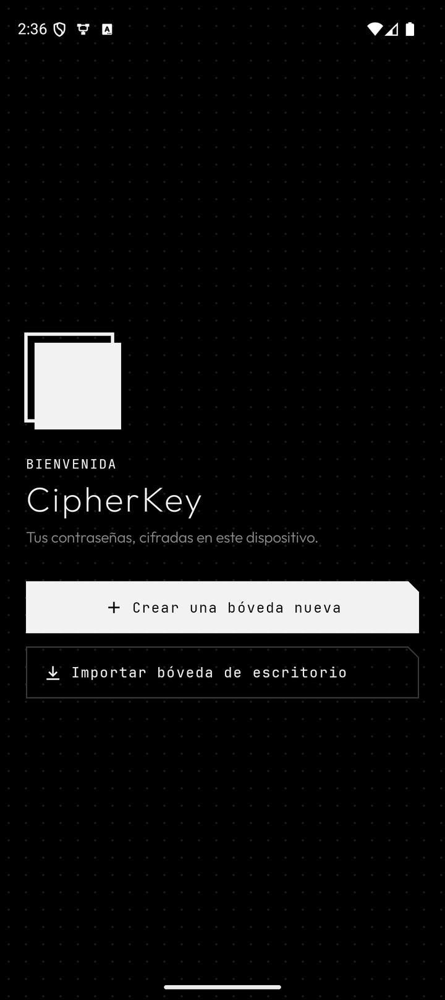
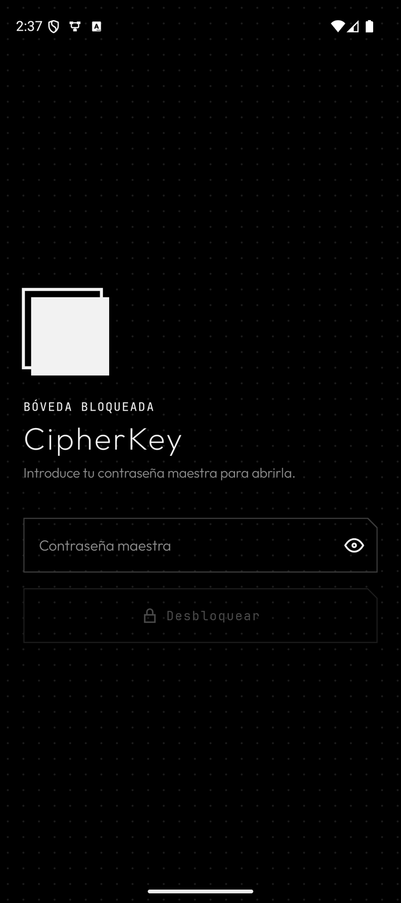
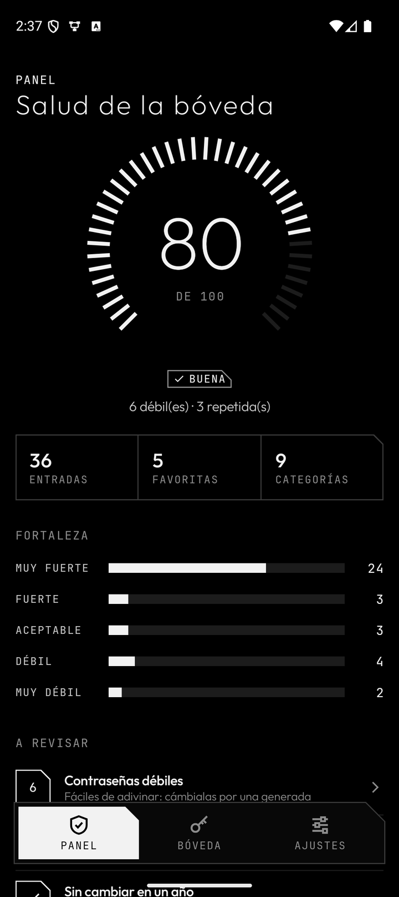
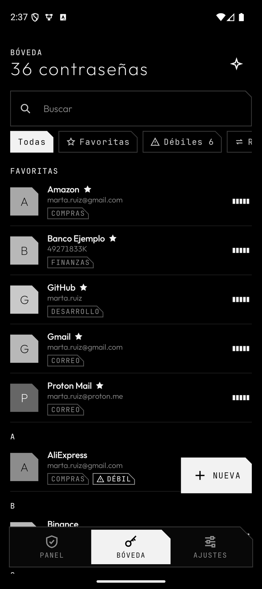
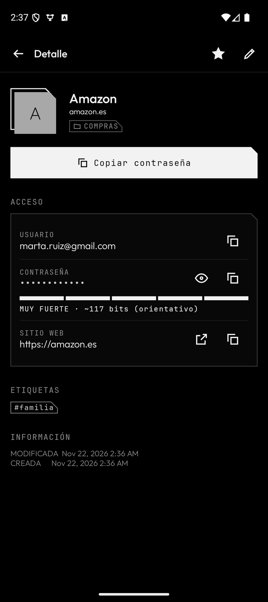
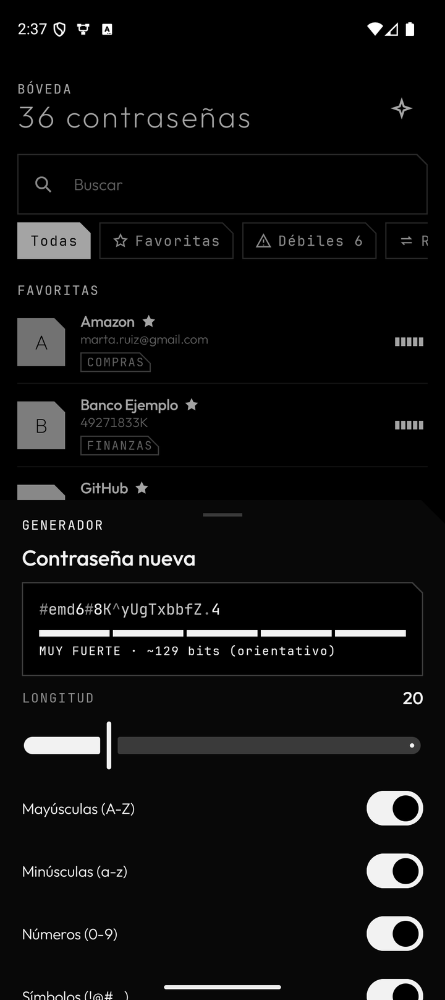
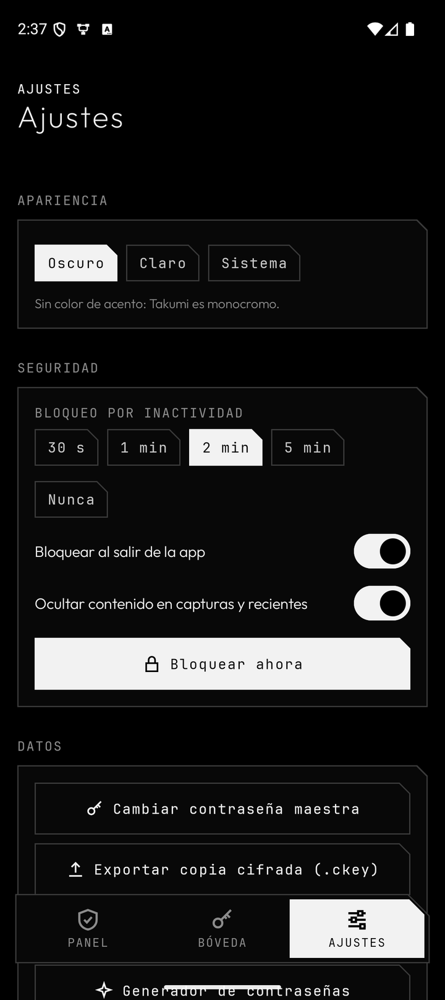
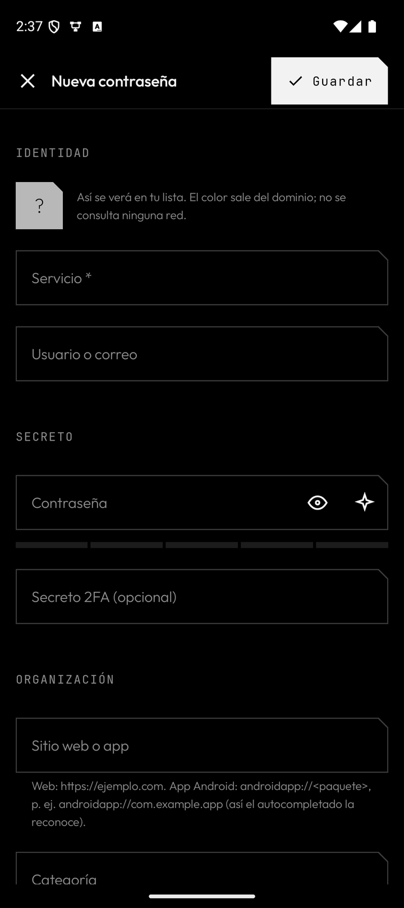

# CipherKey Mobile

Cliente Android del gestor de contraseñas CipherKey (Kotlin, Jetpack Compose) y servidor de sincronización cifrada de extremo a extremo (Rust, axum + SQLite).

| Bienvenida | Desbloqueo | Panel | Bóveda |
|---|---|---|---|
|  |  |  |  |

| Detalle | Generador | Ajustes | Nueva entrada |
|---|---|---|---|
|  |  |  |  |

Capturas reales (`adb screencap`) en un emulador Pixel_API36 (Android 16) con una **bóveda de demostración ficticia** (nombres, correos y contraseñas inventados) que la build de depuración siembra para este fin. Se tomaron con el APK **debug** y con la protección de pantalla desactivada solo en ese emulador; el APK de la release mantiene `FLAG_SECURE` según el ajuste.

```
android/   app Kotlin + Jetpack Compose (módulos :app y :core)
server/    servidor Rust: guarda solo registros cifrados, firmas Ed25519, anti-repetición, revocación
docs/      licencias de las fuentes y capturas
```

## Características

- **Bóveda**: crear, importar `.ckey` v2/v3, editar, favoritos, generador de contraseñas, cambiar la contraseña maestra y exportar una copia cifrada. Pantalla «Salud de la bóveda» con débiles, repetidas y antiguas. No genera códigos TOTP: solo guarda el secreto.
- **Bloqueo** por inactividad y al salir de la app, `FLAG_SECURE` configurable y desbloqueo con la contraseña maestra o con huella (biometría fuerte).
- **Sincronización** con un servidor propio (alta, emparejado por código, conflictos y su resolución, WorkManager) y **sincronización en proximidad** por la red local, sin servidor (con la bóveda desbloqueada: vinculación con código de 6 dígitos, resumen previo y copia de seguridad cifrada).
- **Autocompletado**: servicio con autenticación a nivel de Dataset y emparejado estricto por dominio o por `androidapp://<paquete>`.

### Modelo de seguridad (lo que documenta el repositorio)

- El servidor solo guarda **registros cifrados** (extremo a extremo), con firmas Ed25519, protección anti-repetición y revocación de dispositivos.
- El formato de bóveda, la criptografía, la fusión y el protocolo de sincronización están en un módulo compartido con el cliente de escritorio (véase «Compilar»); la clave de la bóveda se envuelve con el Keystore de Android y una prueba instrumentada lo cubre.
- La primera fusión entre dos bóvedas distintas nunca sustituye ni borra entradas; el mismo identificador con contenido distinto queda como conflicto.
- Detalle y límites en [docs/NOTAS-TECNICAS.md](docs/NOTAS-TECNICAS.md). Este README no añade afirmaciones de seguridad nuevas ni hay una auditoría externa.

## Instalación

Descarga `cipherkey-mobile-0.1.0.apk` de la [última release](../../releases/latest) y comprueba el `sha256` publicado junto a él:

```
sha256sum -c cipherkey-mobile-0.1.0.apk.sha256
adb install -r cipherkey-mobile-0.1.0.apk
```

> **Aviso:** el APK está **firmado con la clave de depuración** de Android (el módulo `app` no define firma de release; el APK `release` compilado se firmó con `apksigner` y esa clave). Es una versión de prueba: no es una firma de producción, no pasa por Play Store ni Play Protect y Android puede avisar al instalarlo. No guardes en ella contraseñas que no puedas perder. Requiere Android 8.0 (API 26) o superior.

## Permisos

| Permiso | Para qué |
|---|---|
| `INTERNET` | Sincronizar con el servidor propio que configures |
| `USE_BIOMETRIC` | Desbloqueo con huella |
| `ACCESS_WIFI_STATE`, `CHANGE_WIFI_MULTICAST_STATE` | Descubrimiento de dispositivos en la red local (multidifusión) para la sincronización en proximidad |

## Compilar desde el código

Requisitos: JDK 17 o superior (el proyecto compila a Java 17; verificado con JDK 27), Android SDK con la plataforma 37 (`compileSdk 37`, `targetSdk 36`, `minSdk 26`) y el Gradle wrapper incluido (en `android/`).

> **Importante:** el formato, la criptografía, la fusión y la sincronización viven en el módulo `core` del cliente de escritorio de CipherKey, que Android compila como fuente. La ruta se configura con `ck.core.dir` en `android/gradle.properties` (por defecto `../../CipherKey-Rediseño/CipherKey/core`) y **ese módulo no está en este repositorio**. Sin él, la app no compila; hay que dejarlo en esa ruta o apuntar `ck.core.dir` a una copia.

```
cd android
./gradlew --no-daemon :app:assembleDebug
./gradlew --no-daemon :app:assembleRelease     # sale sin firmar (app-release-unsigned.apk)
```

Para firmar el release con la clave de depuración, como hace la release publicada:

```
apksigner sign --ks ~/.android/debug.keystore --ks-pass pass:android \
  --ks-key-alias androiddebugkey --out cipherkey-mobile-0.1.0.apk \
  app/build/outputs/apk/release/app-release-unsigned.apk
```

Servidor (no es necesario para usar la app en local ni la sincronización en proximidad):

```
cd server
CK_ADMIN_TOKEN=<token> CK_BIND=127.0.0.1:8787 cargo run --release
```

Variables: `CK_BIND`, `CK_DB`, `CK_ADMIN_TOKEN`, `CK_OPEN_REGISTRATION`, `CK_TRUST_PROXY`, `CK_TOMBSTONE_DAYS`, `CK_RATE_PER_MIN`. Pon HTTPS delante con un proxy inverso; la build de depuración permite HTTP solo hacia `10.0.2.2` (emulador).

## Pruebas

```
cd android
./gradlew --no-daemon :core:test :app:testDebugUnitTest :app:lintDebug
ANDROID_SERIAL=<serie> ./gradlew --no-daemon :app:connectedDebugAndroidTest   # con emulador; las de sincronización necesitan un servidor local y -Pandroid.testInstrumentationRunnerArguments.ck.admin=<token>
cd ../server && cargo test        # 9 pruebas de integración
```

AGP desinstala la app al terminar las instrumentadas, así que se pierden sus datos locales. Estas pruebas no se han vuelto a ejecutar al preparar esta publicación; sí se compiló el release y se comprobó que instala y arranca sin errores en el emulador. Los resultados anteriores y los escenarios de sincronización están en [docs/NOTAS-TECNICAS.md](docs/NOTAS-TECNICAS.md).

## Identidad visual

Sigue la identidad visual de Takumi-Organization: negro y tinta clara, monocromo estricto (error, aviso y correcto se leen por icono y texto; los avatares de sitio son grises estables por dominio), esquinas rectas con corte diagonal arriba a la derecha, selección por inversión y sin cristal ni desenfoque. Tipografías **Outfit** y **JetBrains Mono**, bajo licencia SIL OFL 1.1: [Outfit](docs/licencias/OFL-Outfit.txt) y [JetBrains Mono](docs/licencias/OFL-JetBrainsMono.txt).

## Estado y límites conocidos

- Sin verificar: sincronización real móvil físico a escritorio con bóvedas reales, descubrimiento por multidifusión entre dos máquinas reales, Wi-Fi con aislamiento de clientes, y la prueba de autofill en un navegador real (Chrome no usa servicios de terceros por defecto).
- Android 17 (target 37) exigirá `ACCESS_LOCAL_NETWORK`; hoy el target es 36 y no se declara (no verificado en un dispositivo con Android 17).
- Cambiar el servidor de sincronización exige desactivar y volver a activar; importar una bóveda descarta la identidad de sincronización (la anterior queda como `.bak`).
- Sin guardado de credenciales nuevas desde el autocompletado; la lista de sufijos públicos del emparejador es mínima.
- La biometría facial que Android clasifica como «de conveniencia» no se usa para desbloquear: solo la biometría fuerte.

## Licencia

[MIT](LICENSE), © 2026 Takumi-Organization. Las fuentes Outfit y JetBrains Mono se distribuyen bajo SIL OFL 1.1. Dependencias de la app: AndroidX y Compose (Apache 2.0); del servidor: axum, tokio, rusqlite y ed25519-dalek (licencias permisivas MIT, Apache 2.0 o BSD; las dependencias transitivas no se han auditado una a una). El módulo `core` compartido del cliente de escritorio no forma parte de este repositorio y tiene su propia licencia.
